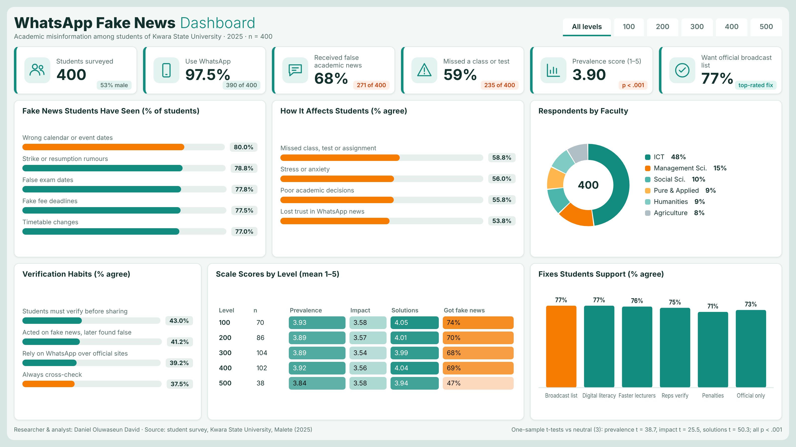

# WhatsApp Fake News Analysis (Kwara State University)

At KWASU most academic updates move through WhatsApp class groups, and so does a lot of false information: fake exam dates, fake fee deadlines, strike rumours. Students act on these messages and some of them miss classes or tests because of it. I designed the analysis for a survey of 400 students and analysed it to measure how common the problem is, how it affects students and what they think would fix it.

Key Points:
* WhatsApp is the main channel: almost every student gets academic news from class groups.
* False updates spread fast: fake dates and rumours reach most students.
* Real effects: missed classes, stress and bad decisions.
* Official channels are slow, so students fall back on whatever is forwarded to them.

Tools I used: SQL Server, Python (pandas, SciPy), SPSS, Excel, Power BI

Data: 400 students across six faculties, all levels, collected in 2025. Most questions use a 5-point scale (1 = strongly disagree, 5 = strongly agree).

## Objectives
1. Measure how common fake academic news is on WhatsApp
2. Find the most common types
3. See how it affects students' studies, stress levels and decisions
4. Find out which solutions students support

## Dashboard


## What I found
* 97.5% of the students use WhatsApp, and 68% agreed they have received false academic information on it.
* Roughly 4 in 5 students have seen wrong calendar dates, strike or resumption rumours, or false exam dates.
* 59% missed a class, test or assignment because of fake news, and 56% said it caused them stress or anxiety.
* Only 38% always cross-check what they receive.
* All three scale scores are clearly above neutral (one-sample t-tests, all p < .001): how common it is (3.90 out of 5), its impact (3.56) and support for solutions (4.01).

## Recommendations
* An official university WhatsApp broadcast list for verified updates (77% support it)
* Digital literacy as part of student orientation (77%)
* Course reps should confirm information before sharing it in class groups
* Lecturers and departments should post updates faster, so rumours have less room

## Repo structure
```
Data/
  survey_responses.csv     survey export (timestamps removed)
  codebook.csv             what each column means
Scripts/
  dim_students.sql
  fact_prevalence.sql
  fact_misinformation_types.sql
  fact_impact.sql
  fact_solutions.sql
Statistical Analysis/
  t_tests.py
  t_test_results.csv, scores_by_level.csv
Dashboard/
  dashboard.png / dashboard.html
  Excel workbook (dashboard, a chart for every question, data, tests)
```

## How to run it
1. In SQL Server create a database called KwasuSurveyDB and import `Data/survey_responses.csv` as `dbo.survey_responses` (Tasks > Import Flat File).
2. Run the scripts in the Scripts folder:
   * dim_students.sql
   * fact_prevalence.sql
   * fact_misinformation_types.sql
   * fact_impact.sql
   * fact_solutions.sql
3. Load the query results into Power BI (Get data > SQL Server) to build the dashboard.
4. Run `Statistical Analysis/t_tests.py`. It reads from SQL Server, or from the CSV if SQL Server is not set up, and saves the results to t_test_results.csv, scores_by_level.csv.


Researcher and analyst: Daniel Oluwaseun David. The data is anonymised, students are identified only by a number.
